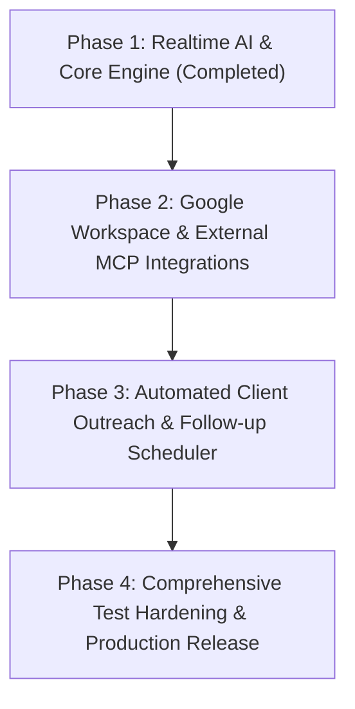

# TaskMate AI — V1 Implementation & Release Plan

**Document Version**: 1.0.0  
**Target Release**: TaskMate AI V1.0  
**Audit Baseline**: [SRS Gap Matrix](file:///D:/TaskMateAI/docs/SRS_GAP_MATRIX.md)  
**Lead Engineer**: Lead Systems Architect & AI Engineering Team  

---

## 1. Release Goals & Overview

TaskMate AI V1 is positioned as an intelligent personal operating system for freelance software engineers, automating:
1. **AI Requirements Engineering**: Turning messy client emails/briefs into professional specifications with testable Given-When-Then acceptance criteria, atomic functional requirements, non-functional constraints, and auto-generated task breakdown plans.
2. **AI Assistant & Agent Runtime**: Context-aware natural language assistant connected directly to the user's workspace, GitHub repositories, and Google Workspace calendar/mail via the Model Context Protocol (MCP).
3. **CRM & Client Communication**: Client lifecycle tracking, automated outreach follow-up drafting, and project delivery milestones.
4. **Reliability & Enterprise Security**: Token encryption at rest (Fernet), fine-grained multi-tenant user isolation, resilient AI model fallbacks, and zero data leakage.

---

## 2. Implementation Phases & Milestones



### Phase 1: Real-Time AI Requirements & Chat Assistant (Completed Baseline)
- **Status**: Completed & Verified.
- **Deliverables**:
  - Direct integration with Google Generative AI via `gemini-2.5-flash` at `< 2s` inference latency.
  - Token expansion to 8192 output tokens to prevent JSON truncation on extensive requirements analyses.
  - Dynamic extraction & sanitization pipeline eliminating generic placeholder text and prompt metadata leakage.
  - Live AI Chat and agent tool execution connected to SQLite database.
  - Pre-configured Fernet encryption keys for GitHub and external tokens.

### Phase 2: Google Workspace OAuth & Production MCP Server
- **Objective**: Complete Google Workspace user-facing connection for Calendar synchronization (FR-46) and email drafting (FR-34, FR-39).
- **Tasks**:
  1. Complete Google OAuth2 web client flow (`/settings/integrations/google/callback`).
  2. Implement token storage in the `user_tokens` table with the configured `TOKEN_ENCRYPTION_KEY`.
  3. Support Google Calendar event creation, conflict detection (FR-49), and meeting synchronization (FR-46).
- **Acceptance Criteria**:
  - User can click "Connect Google Workspace", authenticate via Google OAuth consent screen, and see "Connected" status in settings.
  - Creating a meeting in TaskMate triggers an API call that posts the event to Google Calendar.
  - Overlapping events trigger a visual and toast alert for scheduling conflicts.

### Phase 3: Automated Outreach & Quotation Document Generator
- **Objective**: Complete automated proposal/quotation PDF generation (FR-30, FR-31) and email dispatch automation (FR-36, FR-41).
- **Tasks**:
  1. Add PDF invoice/quotation rendering module with branded freelance invoice templates.
  2. Implement client follow-up reminder daemon with customizable dispatch triggers.
  3. Provide interactive draft-and-edit UI before any outgoing message is transmitted.
- **Acceptance Criteria**:
  - User can click "Download Quotation PDF" on any approved requirement set and receive a formatted PDF.
  - Automated follow-up messages require explicit user approval before sending (human-in-the-loop guarantee).

### Phase 4: Test Hardening, CI/CD, and V1 Release
- **Objective**: Ensure end-to-end regression safety, automated linting, and production containerization.
- **Tasks**:
  1. Add full Next.js Jest tests for requirements viewer and CRM screens.
  2. Add end-to-end integration tests for Google Workspace token encryption.
  3. Verify Docker compose multi-container deployment (`apps/api` + `apps/web`).
- **Acceptance Criteria**:
  - `pytest` passes with 100% success rate across all modules.
  - Frontend Jest test suite passes without memory leaks or warnings.
  - Prettier formatting check and ESLint pass with zero errors.

---

## 3. Immediate Setup Instructions for the User

### 1. Gemini AI Integration (Active & Ready)
Your Gemini API Key is configured in `apps/api/.env` using the official Google Gemini endpoint with model `gemini-2.5-flash`. Both the AI Assistant Chatbot and the Real-time Requirements Analyzer are live and operational.

### 2. GitHub Token Encryption (Active & Ready)
The Fernet encryption key is generated and configured in `apps/api/.env`:
```env
TOKEN_ENCRYPTION_KEY=UztKdHQ_3fDBCBgWh_Y8API-zax_H0_zMHMQAdZGKV4=
```
You can now safely input your GitHub Personal Access Token in **Settings -> Integrations -> GitHub** without encountering the encryption error.

### 3. Google Workspace Connection Instructions
Because Google Workspace (Gmail & Calendar) uses Google OAuth2 rather than an API key:
1. Open [Google Cloud Console](https://console.cloud.google.com/apis/credentials).
2. Create an **OAuth 2.0 Client ID** (Application type: *Web application*).
3. Add Authorized Redirect URI:
   ```
   http://localhost:3000/settings/integrations/google/callback
   ```
4. Paste the credentials into `apps/api/.env`:
   ```env
   GOOGLE_OAUTH_CLIENT_ID=<your-client-id>
   GOOGLE_OAUTH_CLIENT_SECRET=<your-client-secret>
   ```
5. Click **Connect Google** under **Settings -> Integrations** in the TaskMate UI.

